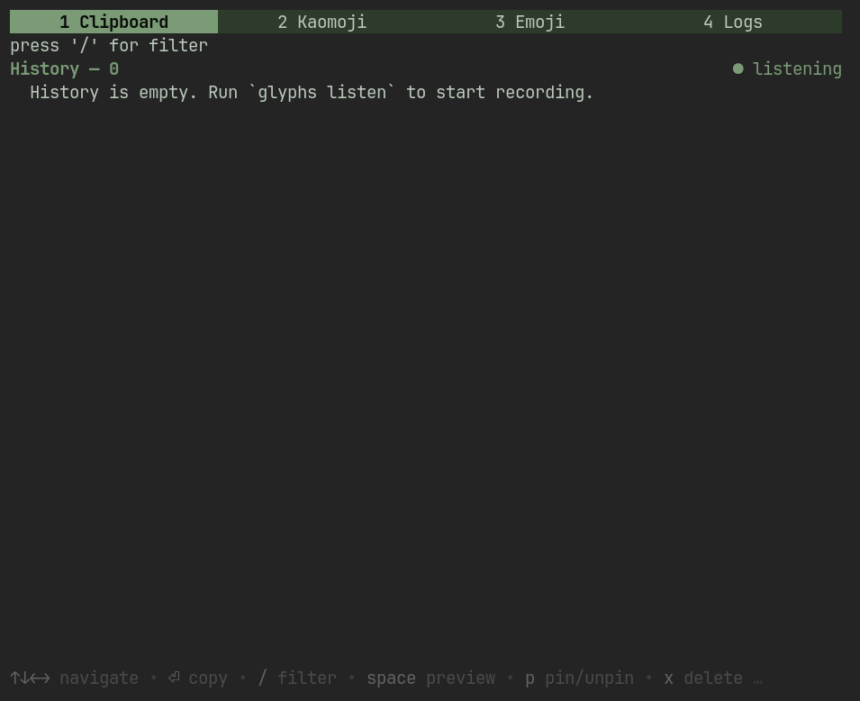
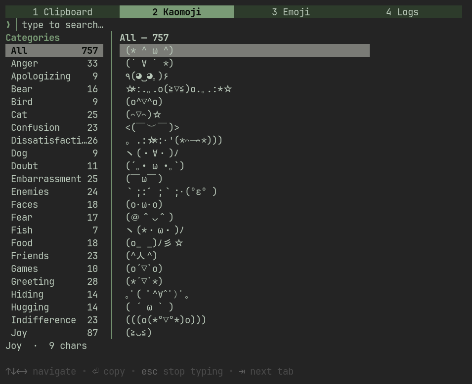
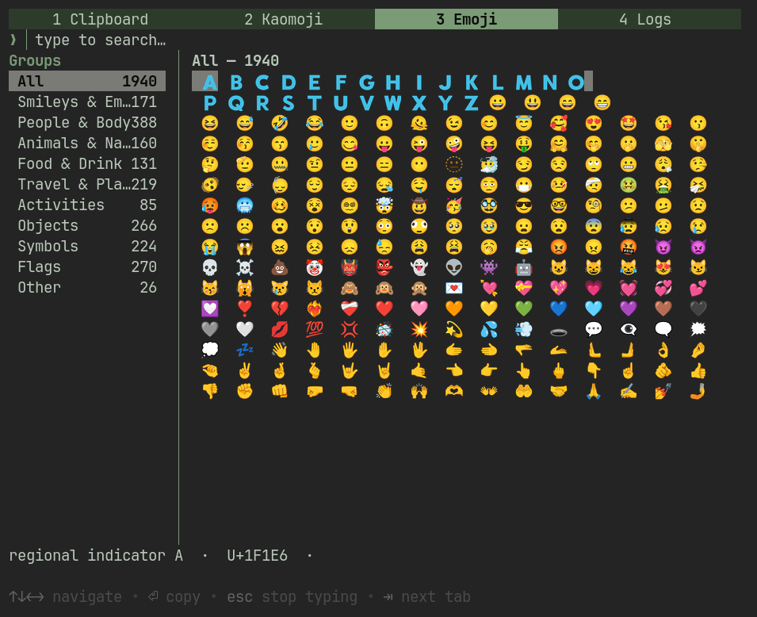
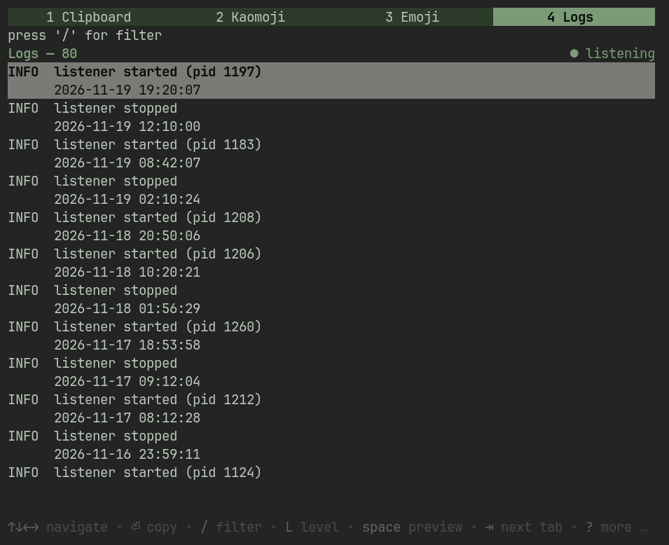

# glyphs

[](https://github.com/AtumnMoon/glyphs/actions)
[](https://github.com/AtumnMoon/glyphs)
[](https://github.com/AtumnMoon/glyphs/issues)

Kaomoji picker, emoji picker and clipboard-history manager in one terminal UI.
The clipboard side is inspired by [clipse](https://github.com/savedra1/clipse).

It works in Windows, MacOS, and Unix-systems such as Linux and BSD.

Note: This is extremely customized based on what I want, but if you wanna use it, feel free.

### Table of Contents

- [Configuration](#Configuration)
- [CLI](#CLI)
- [Tabs](#Tabs)
- [Clipboard](#Clipboard)
- [Symbols](#Symbols)
- [Logs](#Logs)

## Configuration

glyphs writes a fully commented `config.toml` on first run. Every option, key
binding, colour and UI string is listed in [doc/Configuration.md](doc/Configuration.md).

## CLI

glyphs uses subcommands (built with Cobra). `glyphs --help` and
`glyphs <command> --help` describe everything, shell completions come from
`glyphs completion bash|zsh|fish`, and release archives ship man pages.

```sh
glyphs listen                  # start the background listener (replaces a running one)
glyphs listen --foreground     # run the listener in this process (debugging, systemd)
glyphs kill                    # stop the listener
glyphs pause 5m                # pause recording (30s, 5m, 1h ...); `glyphs pause off` resumes
glyphs add <text>              # add to history without copying (or pipe stdin)
glyphs copy <text>             # copy to the system clipboard (or pipe stdin)
glyphs paste                   # print current clipboard text
glyphs output                  # print all text entries, one per line (newlines escaped)
glyphs output --unescaped      # same, entries verbatim
glyphs clear                   # remove everything except pinned entries
glyphs clear --all|--images|--text
glyphs clean                   # sanitise text, drop orphaned images/entries
glyphs --keep                  # open the TUI and stay open after copying
glyphs --version
```

Example usage:
```
glyphs                      # open the TUI
glyphs --tab emoji          # open on a given tab (clipboard | kaomoji | emoji | unicode | nerd | logs)
glyphs listen               # record clipboard changes in the background
```

## Tabs

| Tab | What it does |
| --- | --- |
| **Clipboard** | History list (opens first). Pin, multi-select, delete, fuzzy search, live updates. `Space` opens a full-pane preview. |
| **Kaomoji** | Category list + grid. |
| **Emoji** | Group list + grid, `t` cycles skin tone. Search box is focused when the tab opens. |
| **Unicode** | Block list + grid. |
| **Nerd** | Set list + grid. |
| **Logs** | What the listener has been doing, and what is wrong with your config. Filter by level (`L`) or by words (`/`). |

## Clipboard



### Keys
All rebindable (press `?` in the app).

- Arrows or `hjkl` for movement
- `Enter` copies,
- `/` searches,
- `Tab` / `Shift+Tab` switch tab.
- Clipboard: `p` pin
- `Ctrl+P` pinned-only,
- `x` / `Backspace` delete (asks first for pinned)
- `s` / `Shift+↑↓` multi-select
- `Space` preview.
- `v` select mode, `m` move mode (below).
- `e` edit the entry in `$VISUAL` / `$EDITOR` (below).

### Clipboard preview

Closed by default. `Space` opens it over the whole pane, like clipse: `↑↓`
scroll a line, `←→` a page (with a scroll percentage), `Enter` copies, `Space`
or `Esc` closes. Images are drawn as a real bitmap in terminals that support
sixel (foot, WezTerm, mlterm, ...). glyphs asks the terminal at startup, so no
setup is needed. Elsewhere it falls back to a half-block approximation.

Set `image_preview` to `sixel`, `basic` or `off` to force a mode. Default is `auto`.

### Editing an entry

`e` opens the highlighted text entry in `$VISUAL`, then `$EDITOR`, then `vi`. The
UI is suspended while the editor runs and comes back when it exits. The entry
keeps its position, pin and time. Details:

- The variable is split on spaces, so `EDITOR="code --wait"` works. Quoting is not
  supported: point it at a small script for anything fancier.
- Only the newline your editor adds at the end is dropped. Saving an empty file,
  or an unchanged one, or quitting the editor with an error, changes nothing.
- The text goes through a file in a fresh private directory (mode 0700, file 0600),
  which is deleted afterwards along with any swap or backup files the editor
  left beside it. Clipboard text is often secret, so nothing is left in `/tmp`.
- If the new text equals another entry and `allow_duplicates` is off, the other
  one is removed and the survivor is pinned if either was.
- One text entry at a time: with several selected, glyphs asks you to clear the
  selection (`S`). Images can't be edited.

### Modes

The same movement keys do different things depending on the
mode, and the header shows which one you are in. Normal mode is what you start
in.

| Mode | Enter | What the arrows do | Leave |
| --- | --- | --- | --- |
| **Normal** | | move the cursor | |
| **Select** | `v` | extend the selection from where you pressed `v` (moving back shrinks it) | `v` or `Esc`; the selection is kept |
| **Move** | `m` | carry the highlighted entry, or the whole selection, up and down; `Home`/`End` send it to the top/bottom | `Enter` saves the order, `Esc` throws it away |

In select mode the usual commands work on the selection (`Enter` copies, `p`
pins, `x` deletes, `m` moves). A selection you had before pressing `v` is kept.

Move mode edits a draft in memory and writes the history once, on `Enter`, so
there is nothing to undo and a refresh cannot clobber it. If the listener
records something meanwhile, the new entry is kept at the top when you save.
Move mode needs an unfiltered list; in the pinned-only view an entry hops over
the hidden ones, so the order you see is the order you get. A pinned entry
that you copy again keeps its place instead of jumping to the top, so an order
you arranged by hand lasts. (Unpinned entries still move to the top when copied
again, unless `allow_duplicates` is on.)

## Symbols





Browse kaomoji, emoji, unicode and nerd-font symbols, and press `/` to filter any of them.

## Logs

Logs Tab


The listener writes its own log file (`log_file`, default `glyphs.log` in the
config dir; it rotates at 1 MiB), whether you started it with `glyphs listen`
or under systemd, so this tab works either way. Newest entries are on top and
the tab updates live. A cursor on the first row follows new entries, like
`tail -f`.

- `L` cycles the level: all → error → warn → info. Only that level is listed.
- `/` filters by words: every word must appear (case-insensitive) in the message
  or the level, so `refused config` finds the line explaining why the listener did
  not start, and `error` finds every error.
- `Space` opens the whole message, wrapped; `Enter` copies it.
- Problems with your `config.toml` (the error, or warnings such as an unknown
  option) are listed first, and a `⚠ config` badge appears in the clipboard
  header while there are any. Open this tab to read them.
- If the listener refuses to start because of the config, it logs why here too.

## Install

### Pre-built Binaries

Download the archive or binary matching your OS and architecture
from the [Releases page](https://github.com/AtumnMoon/glyphs/releases),
then move it to a directory in your `$PATH` (e.g., `/usr/local/bin` on Linux/macOS):

### From Source

If you have `go` installed:
```
go install github.com/AtumnMoon/glyphs/cmd/glyphs@latest
```

## Systemd Service

Use the unit in [`contrib/glyphs-listener.service`](contrib/glyphs-listener.service):

```sh
mkdir -p ~/.config/systemd/user
cp contrib/glyphs-listener.service ~/.config/systemd/user/
systemctl --user daemon-reload
systemctl --user enable --now glyphs-listener.service
```

It runs `glyphs listen --foreground`. Do not point a unit at plain
`glyphs listen`: that command starts a detached child and exits, so systemd
sees the service finish and kills the child with the rest of the service's
control group, which leaves the TUI showing "listener off". Any other
supervisor that tracks the process it starts (runit, s6, ...) needs
`--foreground` for the same reason.

## Development

```
go build ./...
go test ./...
```

## Credits

The clipboard-manager side of glyphs (history file format, listener, CLI and
config design) is inspired by [clipse](https://github.com/savedra1/clipse) by
M Savedra (MIT licensed). glyphs is an independent implementation built on
Bubble Tea v2 and `golang.design/x/clipboard`, and adds the kaomoji, emoji,
unicode, and nerd symbol pickers.

## License

MIT, see [LICENSE](LICENSE).
